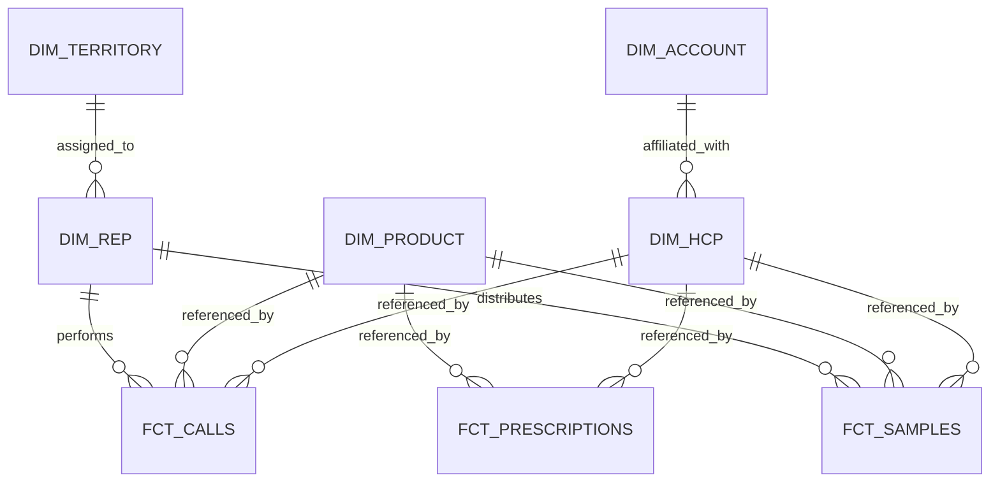

# 05 – Data Model and Relationships

## 1. Modeling approach

The target warehouse will use a dimensional modeling approach:

- Dimensions provide descriptive context.
- Facts store measurable business events or periodic measures.
- Analytical marts aggregate facts to business reporting grains.

The exact model grain and keys must be validated before implementation.

## 2. Candidate source relationships

| From | Key | To | Key | Relationship |
|---|---|---|---|---|
| Calls_Interactions | npi | HCP_master | npi | Many calls to one HCP |
| Calls_Interactions | product_id | Product | product_id | Many calls to one product |
| Calls_Interactions | rep_id | Roster | rep_id | Many calls to one representative |
| Calls_Interactions | territory_id | Territory | territory_id | Many calls to one territory |
| Samples | npi | HCP_master | npi | Many sample records to one HCP |
| Samples | product_id | Product | product_id | Many sample records to one product |
| Samples | rep_id | Roster | rep_id | Many sample records to one representative |
| Samples | call_id | Calls_Interactions | call_id | Optional call association |
| Xponent | npi | HCP_master | npi | Many periodic records to one HCP |
| Xponent | product_id | Product | product_id | Many periodic records to one product |
| HCP_master | account_id | Account_master | account_id | Many HCPs to one account |
| HCP_master | territory_id | Territory | territory_id | Many HCPs to one territory |
| Roster | territory_id | Territory | territory_id | Representative-to-territory assignment |
| Specialty_product_map | primary_product_id | Product | product_id | Specialty-to-product mapping |

These are candidate logical relationships. Some joins may require effective-date handling if historical attributes are retained.

## 3. Candidate dimensional model

### Dimensions

| Model | Candidate grain | Candidate key |
|---|---|---|
| dim_product | One row per product | product_id |
| dim_territory | One row per territory | territory_id |
| dim_hcp | One row per HCP/current version | hcp_id; validate NPI |
| dim_account | One row per account/current version | account_id |
| dim_rep | One row per representative/current version | rep_id |
| dim_date | One row per calendar date | date_key |

`dim_date` may be generated within the warehouse/dbt project rather than sourced from a CSV.

### Facts

| Model | Candidate grain | Candidate key |
|---|---|---|
| fct_calls | One row per call | call_id |
| fct_samples | One row per sample distribution | sample_id |
| fct_prescriptions | One row per confirmed Xponent grain | To be confirmed |

Do not create `fct_prescriptions` until its grain is confirmed.

## 4. Fact-table design cautions

- Keep Calls, Samples, and Xponent at their own declared grains.
- Do not join all three detailed fact tables into one wide fact.
- Use conformed dimensions where the business keys and temporal meaning align.
- If HCP or Account attributes change, decide whether reports should use current attributes or attributes effective at event time.
- Use surrogate keys if implementing historical dimension versions.

## 5. Conceptual relationship diagram

## 6. Slowly Changing Dimensions

Initial recommendation:

- Start with Type 1/current-state dimensions for simplicity.
- Consider Type 2 for one dimension only after confirming meaningful historical changes and the reporting requirement.
- Potential candidates: HCP, Account, or Roster.
- Type 2 requires effective start/end timestamps or dates, a current-row indicator, and a surrogate key.
- Do not implement Type 2 merely because multiple monthly files exist; first establish whether they represent real attribute changes.

## 7. Join validation

Before building marts, test:

- Unmatched foreign keys.
- Duplicate dimension business keys.
- Join cardinality.
- Row counts before and after joins.
- Fact measure totals before and after joins.

A dimension join should not unexpectedly increase the number of rows in a fact model.
