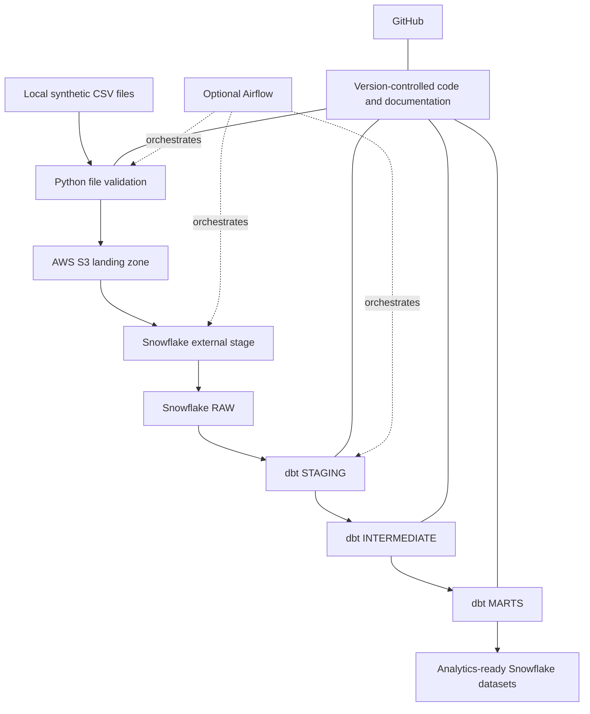

# 06 – Architecture and Technology

## 1. Target architecture

## 2. Technology responsibilities

| Technology | Responsibility | Project usage |
|---|---|---|
| Python | File handling and automation | Validate files, upload, trigger processes, capture logs |
| AWS S3 | Object storage | Store source CSV files in a landing structure |
| AWS IAM | Access control | Grant least-privilege access to S3 |
| Snowflake | Data warehouse | Store RAW, STAGING, INT, MARTS objects |
| Snowflake storage integration | Secure S3 access | Allow Snowflake to read approved S3 locations |
| Snowflake stage/file format | File ingestion configuration | Define source location and CSV parsing |
| SQL | Query and transformation language | Warehouse logic and validation |
| dbt Core | Transformation framework | Models, tests, macros, snapshots, docs |
| Git/GitHub | Version control | Track code and documentation |
| VS Code | Development IDE | Edit and execute project code |
| Apache Airflow | Optional orchestration | Schedule and monitor pipeline tasks |

## 3. Snowflake logical structure

Existing project setup, as previously described:

- Database: `PHARMA_DB`
- Warehouse: `PHARMA_WH`
- Schemas: `RAW`, `STAGING`, `INT`, `MARTS`

Confirm the actual account objects and dbt target configuration before running DDL. Do not create duplicate objects if they already exist.

## 4. Layer responsibilities

| Layer | Responsibility | Expected object types |
|---|---|---|
| RAW | Source-aligned ingested data and technical metadata | Tables |
| STAGING | Source standardization and basic cleaning | Views initially |
| INT | Reusable joins and business transformations | Views/tables as justified |
| MARTS | Facts, dimensions and analytical outputs | Tables/incremental models as justified |

## 5. Architecture principles

- S3 is the landing/storage layer; Snowflake is the analytical warehouse.
- dbt does not replace ingestion. It transforms data already available in Snowflake.
- Airflow, if added, coordinates task execution; it does not replace dbt transformations.
- Keep credentials outside source control.
- Use separate development and production targets only when the project requires them; avoid unnecessary environments for a small trial project.
- Prefer Snowflake-native loading and dbt transformations over moving large datasets through local Python unnecessarily.

## 6. Deployment and environment assumptions

- Development is performed locally in VS Code.
- dbt Core is installed locally.
- Snowflake and AWS trial/free-tier availability and limits must be checked before use.
- The architecture is a learning/portfolio implementation, not a production service-level commitment.
